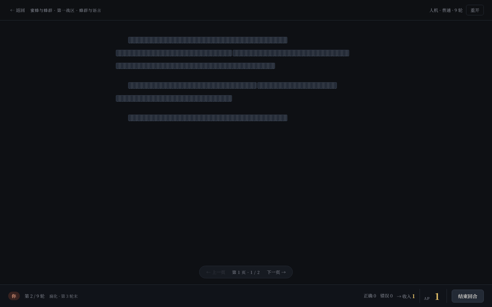
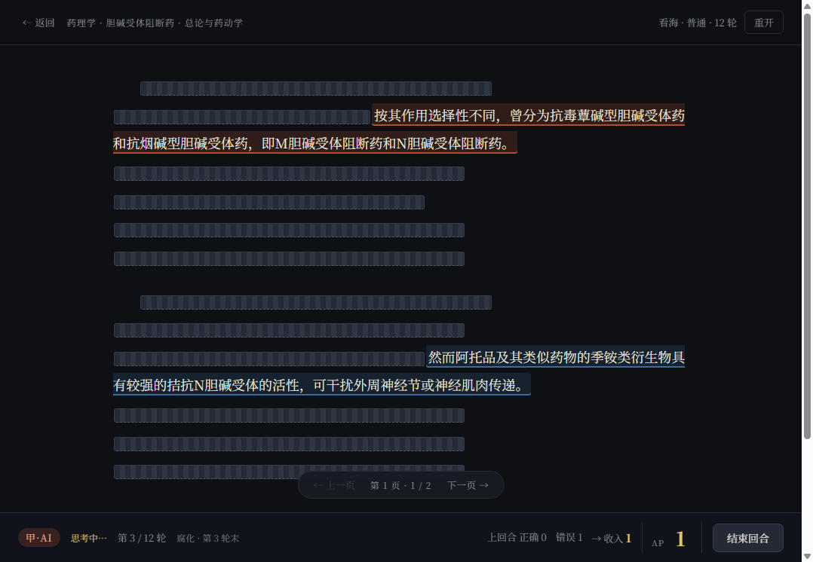

# 一款AI制作的知识密集型战旗游戏——sentences

**▶ 在线开玩：<https://gushengsheng.github.io/sentences/>**

github:https://github.com/gushengsheng/sentences

# 特点

- **可及**：支持手机、电脑，不用安装、注册。
- **轻便**：src源文件仅101.5 KB。
- **拓展与体验**：自带基于课本制作的demo地图。
- **简洁**：仅7条规则，规则简洁（1个机制+4个操作+1个计算公式+1个胜负判定）
- **创意**：基于记忆理论和游戏反馈理论制作。

# 怎么玩

棋盘上是一本书的句子，但其中一部分被人悄悄改过了。

你要做的只有一件事：**把正确的句子变成自己的，把被改坏的句子找出来修好。**

## 你看到的和能做的

一句话铺在棋盘上，盖着墨条。点一下就是「占领」，花费 1 点行动力(1AP)，句子「显露」并被「占领」。

露出来之后游戏不会再提示你对错——**是原话还是被改过，得你自己读出来**。这是这游戏的门槛，也是它的乐趣。

除了「占领」还可以进行：
**修正** **进攻** **放弃** 三个操作

## 每回合，就那么几件事
你每回合有行动力（AP）。手里的真话和假话决定能做几件事，但行动力永远比想法少——这是游戏的压力来源。

| 动作 | 花费 | 干什么 |
|---|---|---|
| **占领** | 1 点 | 拿走一句无主的句子，同时看到内容 |
| **修正** | 1 点 | 只能对自己手上的句子用。弹出 4 个版本，选出忠实原文的那个 |
| **进攻** | 2 点 | 把对方的一句打回无主 |
| **放弃** | 0 点 | 把自己那句扔掉，止损 |

修正的风险：**选对了这句变成「正确」，选错了则浪费1AP**。

## 钱从哪来

每回合结束时结算一次：

> 你手上「正确的句子数 − 错误的句子数」，至少给 1 点。下一回合到账。AP(n+1)=max{1,1+true-flase}

「多占领」不是目的，占下来的句子对不对才是。

## 灾难机制

每过 3 轮，触发一次**灾变**：灾难、分裂、休克、静默、潮汐。

你手上每句正确的话，都有 1/4 概率被静默破坏。

这就是为什么游戏不能一劳永逸：守得住，才能撑到终局。

提供反复间隔查询一个句子的机会：增强记忆效率。

## 怎么赢

到约定轮数（默认 12 轮）结束，比较双方**得分 = 正确句数 − 错误句数**。得分高者胜；**平分就是平局，谁都不算赢，也不计入「已通关」**。

不用读完整本书：一个「知识碎片」就是一小节内容，一局十来分钟，手机上随手能来一盘。

## 规则速查

| 项 | 规则 |
|---|---|
| 棋盘 | 句子按原句切分，没有邻接限制，任意可点 |
| 句子属性 | 归属（无主 / A / B）、正确性（正确 / 错误） |
| 收入 | 每回合 `max(1, 1 + 己方正确数 − 己方错误数)` |
| 占领 | 1 AP，揭示并归己方 |
| 修正 | 1 AP，4 选 1；选对变正确，**选错会把句子改错** |
| 转化 | 2 AP，把对方句子打回无主 |
| 放弃 | 0 AP，丢掉己方句子 |
| 灾难脉冲 | 每 3 轮结束，己方每个正确句子有 1/4 概率变错，无提示 |
| 胜负 | 到指定轮数后，比较「正确 − 错误」的得分，高者胜；平分算平局，不计通关 |

## 内置看海机制

放松时间就看电子斗蛐蛐。

## 反馈回路

游戏设计理念：用高反馈协助对抗阅读的枯燥无趣。

## 现在能玩什么

| 书 | 章 | 知识碎片 | 句子 |
|---|---|---|---|
| 药理学 | 4 | 19 | 424 |
| 精神药物 | 1 | 11 | 228 |
| 肾上腺素受体激动药 | 1 | 9 | 205 |
| 蜜蜂与蜂群 | 1 | 2 | 32 |
| 睡眠与节律 | 1 | 1 | 24 |
| **合计** | **8** | **42** | **913** |

药理学四章：绪言 / 药物代谢动力学 / 药物效应动力学 / 影响药物效应的因素。

## 想做一本书？

欢迎进行书籍内容补充！

不用写代码，也不用懂 JSON。项目自带一个「地图锻造」skill（`skills/sentences-map-forge/`）：你把书的原文交给它，自动生成地图文件。

完整字段、加章节流程、上线命令见 [docs/开发文档.md](docs/开发文档.md)。

## 进度与存档

进度存在浏览器本地（`localStorage`），换设备不跟随，清浏览器数据会丢。

## 开发

目录结构、构建、部署到 GitHub Pages、地图 JSON 全字段 —— 见 [docs/开发文档.md](docs/开发文档.md)。

更新日志见 [CHANGELOG.md](CHANGELOG.md)。

## PWA（离线可用）

- 首次联网访问后，页面、脚本、样式、以及**全部书和章节**都会进入缓存，之后断网也能开局
- 手机上「添加到主屏幕」即像 App 一样全屏打开

