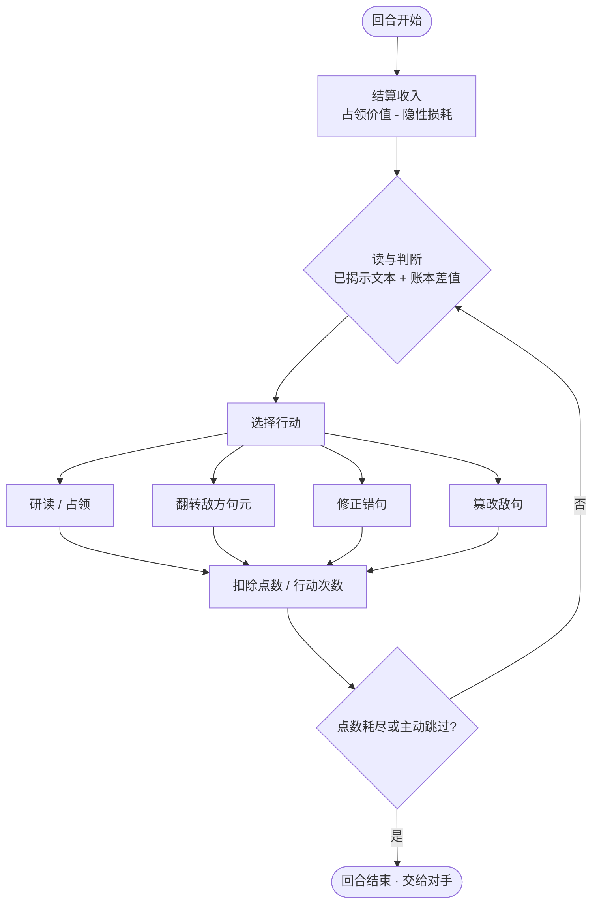

# 句元战棋 · 设计思路 v0.1

> 一句话：把一本书拆成句子战场。每一句都可能被偷偷改错，你读、你判、你抢、你改——用「读得懂」换「打得赢」。

---

## 1. 定位

| 项 | 内容 |
|---|---|
| 类型 | 双人对战 / 单人 PvE · 文本战棋 · 学习辅助 |
| 玩家幻想 | 不是「答题的学生」，是「校勘者」：在迷雾覆盖的文本里推进战线，靠眼力识破篡改，抢下据点，修回原文 |
| 核心情绪 | 好奇 → 怀疑 → 紧张 → 顿悟 → 「我看出来了」 |
| 体验参照 | 战棋的战线推进 + 扫雷的推理快感 + 每日谜题的仪式感 |
| 差异化 | 不是「读完文本再答题」，而是阅读本身就是资源生产；判断真伪是唯一的高价值动作 |

**最重要的一个判断：这游戏的地基不是「答题」，是「阅读产生资源」。** 所有规则都应该围绕这一句收敛——任何让「不读也能赢」的漏洞，都是设计事故。

---

## 2. 三条设计支柱

**P1 阅读即生产力。** 所有收益都来自读懂文本，而不是点得快。占领只是投资，判断才是收益来源。

**P2 真伪是地下信息。** 文字层公开，真伪层隐藏。博弈发生在「我怀疑」和「我确认」之间——这正好是学习发生的地方。

**P3 每次点击都是一次判断。** 没有空转回合。投多少点、打哪一格、修不修，都是对「我认为这里值得 / 这里有问题」的表达。

---

## 3. 核心循环

### 3.1 局内（一回合）

### 3.2 局间（一章）

- **开局**：迷雾覆盖，只有结构可见；双方各占 1–2 句起手。
- **中盘**：争夺高价值句元；开始出现「我怀疑某句是错的但不确定」；篡改开始生效。
- **终局**：框定资产、清点计分、全占即胜。

### 3.3 元循环

复盘 → 错题本 → 难度提升 / 新章节 → 每日挑战（同 seed 同章）。

---

## 4. 为什么这个循环成立

1. **学习行为被直接映射成资源。** 读得越准，占领质量越高，收入越高。认真读是占优策略，不是额外作业。
2. **错句是负资产。** -1/回合 让错句净收益归零。抢到错句 = 接盘，这制造了「先读后抢」的强制力。
3. **毒丸博弈。** 错误句元的税随所有权转移：对手占着错句，你抢过来就自己交税；但修好它又 +3。抢还是不抢，取决于你读没读出来。
4. **修正 +3 是强正反馈。** 值得为它付出侦察和尝试成本，玩家有动机「确认」而不是「猜」。
5. **篡改让「正确」不永久。** 否则玩家一旦框定就一劳永逸，中后期失去张力。
6. **净收入 = 隐藏账本。** 你能算出自己有几句错，但算不出是哪几句——这是自己领土上的扫雷。

---

## 5. 系统拆解

### 5.1 句元与地图

- 句元 = 最小单位，15–60 字；超长按分号/逗号切；切不动的标「不可错」。
- 排版即地形：段落 = 城，标题 = 关隘，引文 = 特殊地形，脚注 = 边缘格。
- 阅读顺序决定邻接；占领与翻转都要求与己方领土相邻（开局首格除外）。

### 5.2 三层迷雾

| 层 | 内容 | 可见性 |
|---|---|---|
| L0 结构 | 段落轮廓、句长、标点 | 始终可见（排版本身是信息） |
| L1 文字 | 句子正文 | 占领或研读后可见 |
| L2 真伪 | 这句是不是错的 | 永远不可直接见，只能推断或尝试 |

迷雾真正藏的**不是文字，是「哪句被改错了」**。这一点想清楚，UI 和规则才不会互相打架。

### 5.3 资源与收入

- 点数：占领、翻转、修正、篡改。花掉即沉没。
- 行动次数（AP，3–4 次/回合）：限制单回合操作数，制造取舍。
- 收入：底薪 + 占领价值（次线性），错句负税。
- 目标手感：每回合收入 3–8 点，单次行动 1–5 点，一局 12 回合。

### 5.4 占领与翻转

- 占领空格：投入 ≥1，驻军 = 投入。
- 翻转：投入 > 对方驻军，差额成为新驻军；平手守方胜。
- 点数被烧掉而不是转移——控制通胀，也让每次投入有真实代价。

### 5.5 真伪、修正、篡改

- 原生错句（约 1/4）：显示错误说法，-1/回合。
- 修正：4 选 1，成功 → 框定 +3/回合；失败 → 保持错误、无提示、锁 1 回合。
- 篡改：把敌方正确句改成错句，打掉框定；每回合限 1 次。
- 被篡改后修回：只恢复 1 点/回合，不回 3 点——篡改留下永久伤痕。
- **关键**：修正动作对**所有**句元开放，对正确句操作就是空耗，不能靠 UI 判断。否则玩家可以靠「能不能点修正」免费扫描出所有错句，整个谜题就没了。

### 5.6 胜负与计分

- 章节制：12 回合或全占。
- 计分 = 占领数 + 修正数 × 2 + 剩余点数 / 3。
- 全占 = 直接胜，是爽点不是唯一路径。

### 5.7 AI 对手

- 同信息集：不给原文答案，只给已揭示文本 + 识别率参数。
- 三档难度调识别率与冒险度，不调数值。
- 人格：激进型、龟缩型、审计型。

### 5.8 内容管线

切句 → 可错性评分 → 生成 3 错 1 对 → 独立校验 → 锁定。

- 高可错性：数字、专名、因果、条件、限定词。
- 不可错：诗意、歧义、依赖外部争议知识。
- 校验三问：是否唯一正确？错误项是否站得住？是否依赖争议知识？

### 5.9 学习层

- 复盘：每个修正/错过/误判 + 错误类型 + 原文对照。
- 错题本：按错误算子归类，间隔复习。
- 难度自适应：按误判率调错句密度与类型。

---

## 6. 错误算子表（内容生成的骨架）

这张表同时是**生成器的指令集**和**错题本的分类法**。

| 算子 | 例子（原句 → 错句） | 难度 | 适用 |
|---|---|---|---|
| 数字/量级 | 30% → 50% | 中 | 说明文、教材 |
| 专名替换 | 张三 → 李四 | 低 | 叙事、历史 |
| 否定翻转 | 不是 → 是 | 低 | 通用 |
| 因果倒置 | 因为 A 所以 B → 因为 B 所以 A | 高 | 论说文 |
| 条件偷换 | 只要 → 只有 | 高 | 论说文 |
| 范围/程度 | 所有 → 部分；必须 → 可以 | 中 | 通用 |
| 时间/顺序 | 已经 → 将要；先 → 后 | 中 | 叙事 |
| 主客颠倒 | A 影响 B → B 影响 A | 高 | 科普 |
| 词义偏移 | 近义词替换 | 中 | 语言学习 |
| 语法/搭配 | 搭配错误、时态错误 | 低 | 语言学习 |

---

## 7. 关键决策记录

| 决策 | 选项 | 选择 | 理由 |
|---|---|---|---|
| 空间性 | 独立格 / 邻接前线 | 邻接前线 | 独立格没有战线，退化成竞价 |
| 迷雾 | 全黑 / 视野扩张 | 视野扩张 | 全黑开局靠随机点，阅读无引导 |
| 修正入口 | 仅错句可点 / 全体可点 | 全体可点 | 否则 UI 替玩家扫描答案 |
| 点数 | 清零 / 可存 | 清零；主动跳过可存 5 点 | 可存则囤点是唯一最优解 |
| 收入 | 线性 / 次线性 | 次线性 2 + 占领数//3 | 防雪球 |
| 胜负 | 全占 / 章节计分 | 章节计分 | 末盘拉锯会拖死 |
| 框定 | 永久 / 易主失效 | 易主失效 | 3 点资产被抢不能瞬间定胜负 |
| 篡改 | 无 / 有 | 有，每回合 1 次 | 让「正确」不永久 |

---

## 8. 手感目标（先定感觉，再调数值）

- 一局 20–30 分钟，12 回合。
- 前 3 回合必须出现第一次有意义的翻转。
- 4–8 回合必须出现「我怀疑，但不确定」。
- 领先者不能在第 6 回合前锁定胜局。
- 修正成功的爽感 > 抢到一格的爽感（+3 vs +1）。

---

## 9. 风险与对策

| 风险 | 对策 |
|---|---|
| 不读也能赢 | 负税 + 修正成本 + 猜错锁回合 |
| AI 错句翻车 | 独立校验 + 不可错降级 |
| 文本太长疲劳 | 一章 24–36 句 |
| 开局无意义 | 视野扩张 + 起手句 |
| 正反馈过强 | 次线性收入 |
| 学习感弱 | 复盘与错题本作为本体 |

---

## 10. MVP 边界

**做**：单章 txt、24–36 句、PvE 三档、占领/翻转/修正/负税/框定、计分、复盘。

**不做**：epub、联机、篡改、每日挑战、多语言。

先验证「读」是不是真的在发生，再谈内容规模和联机。

---

## 11. 待验证假设

- **H1** 玩家会主动读吗？（看停留时长 vs 修正正确率）
- **H2** 负税能被感知吗？（玩家会不会主动审计）
- **H3** 4 选 1 难度合适吗？（正确率应显著高于 25%）
- **H4** 一局真的 20–30 分钟吗？
- **H5** 玩家觉得「我学到了」吗？
